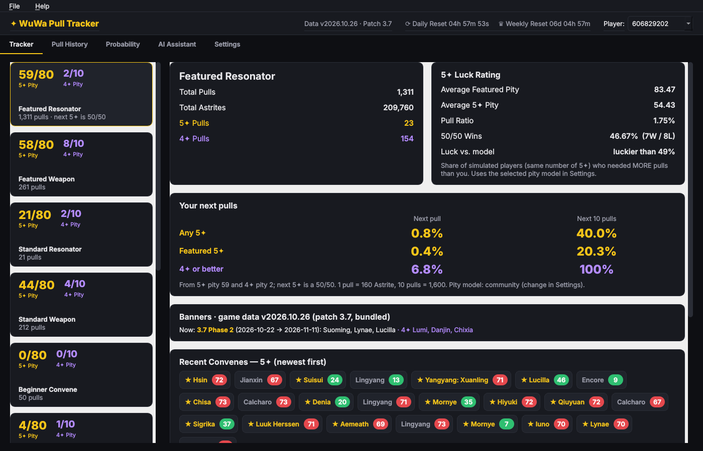

# WuWa Pull Tracker (Windows · offline · Ollama)

[](https://github.com/Nobodey11/WuwaTracker/actions/workflows/tests.yml)




A desktop pull tracker based on the [WuWa Tracker](https://wuwatracker.com) pull tracker, with an exact probability calculator and a local AI assistant.

> **Disclaimer:** This is an unofficial, fan-made project **for personal use only**. It is inspired by and based on the [WuWa Tracker](https://wuwatracker.com) pull tracker (it reads its export format), but it is **not affiliated with, endorsed by or connected to WuWa Tracker (wuwatracker.com), Prydwen.gg, or Kuro Games**. Wuthering Waves and all related names, characters and art are trademarks and © of Kuro Games. Tier lists, ratings and images shown in the Prydwen tab belong to Prydwen.gg and are only loaded for personal viewing, with links back to their site. See [DISCLAIMER.md](DISCLAIMER.md).

## Quick start (Windows)

1. Install **Python 3.11+** from python.org (tick *Add python.exe to PATH*).
2. Download the code (**Code → Download ZIP**, or `git clone https://github.com/Nobodey11/WuwaTracker`) and double-click **`run.bat`**. The first start creates `.venv` and installs the dependencies, which takes about a minute.
3. **☰ menu → Import wuwatracker JSON…** (Ctrl+O) and pick your export (wuwatracker.com → Settings → Export).
   Importing a newer export later only adds the new pulls.

Your data is stored in `%APPDATA%\WuwaTracker\pulls.db` (SQLite, so you can query it with any SQL tool).

### Optional: AI assistant with Ollama
1. Install Ollama from https://ollama.com.
2. In a terminal: `ollama pull qwen2.5:7b` (or `llama3.1:8b`). Choose a model **with tool support** so the
   assistant can call the probability engine. Models without tools still work, using pre-computed facts.
3. Open the **AI Assistant** tab, click ↻ and pick the model.

### Optional: build a standalone .exe
Double-click `build_exe.bat` to get `dist\WuwaTracker\WuwaTracker.exe`.

### Experimental: import straight from the game
In-game, open **Convene → History** once. Then set your game folder in **Settings** and use **☰ menu → Import from game**.
The app reads the history link from the game log and downloads your records, like wuwatracker's import script.
Set **Server region** correctly (the reset timers in your wuwatracker screenshot point to **Asia, UTC+8**),
because the game API returns server-local times.

## Prydwen.gg
The **Prydwen** tab and the portraits use [Prydwen.gg](https://www.prydwen.gg/wuthering-waves)'s public pages. They are
fetched only when needed, cached locally, credited, and linked back to the full guides. Nothing from Prydwen is
stored in this repository (except two trimmed page snapshots used as parser test fixtures). Turn it off in Settings if
you prefer. If Prydwen changes its page layout, the tab shows an error and the parser in `core/prydwen.py` needs an update.

## Staying up to date every patch
All patch-specific data (banners, new characters, standard pool, banner types, pity rates) lives in
`wuwa_tracker/data/game_data.json`, not in the code.
* **Automatic:** after each import the app detects new 5★ characters or banner types and asks you to classify them.
* **Warning:** the header shows ⚠ when the data has no banner for today.
* **Online:** by default the app checks this repo's `game_data.json` on start-up (F5 = check now), so pushing a data update here updates every install.
* **Your routine:** `python tools\new_patch.py scan|phase|check`, see **docs/PATCH_UPDATE.md**.
* **Code updates:** `update.bat` (git pull + tests).

## Tabs

| Tab | What it does |
|-----|--------------|
| Tracker | Banner cards with 5✦/4✦ pity, totals, Astrite, average featured pity, 50/50 record, luck vs. model, 5✦ list and pity chart |
| Pull History | Searchable, sortable table with portraits, rarity/banner filters and patch column |
| Probability | Chance of N featured copies within X pulls (or Astrite + Tides) from your current pity/guarantee, plus expected pulls, 50/90/100 % thresholds and charts |
| Prydwen | Prydwen.gg tier list with portraits and owned badges, a character panel (ratings, best weapons, echo sets), and Prydwen's own website in a built-in browser for the full guides |
| Convene Simulator | Mini-game: free x1/x10 pulls on the current banners with the real pity/50-50 rules and an animated reveal |
| Codes | Active redemption codes (from Prydwen.gg) with rewards, copy button and a redeemed tick-off |
| AI Assistant | Chat with a local Ollama model that calls the app's tools (`get_overview`, `featured_probability`, `pulls_needed`, …) |
| Settings | Ollama host, pity model, game folder, server region, standard 5✦ list, banner names |

## The probability model
Kuro publishes 0.8 % base, soft pity from ~66, and hard pity at 80, but **not** the curve in between. Choose between:
* **Community estimate** (default): +4 %/pull from 66, +8 % from 71, +10 % from 76. This gives about 1.85 % consolidated.
* **Fitted on my pulls**: a Kaplan-Meier hazard estimate from your own 5✦ pities, smoothed with a Beta prior.
* **Flat**: 0.8 % until the hard pity (worst case).

All odds are computed exactly with dynamic programming over (pity, guarantee, copies). There's no random simulation.

## Development
```
pip install -r requirements.txt pytest
python -m pytest tests          # set WUWA_SAMPLE=path\to\export.json to also check the numbers against wuwatracker
python -m wuwa_tracker.app --import path\to\export.json
```
See `PLAN.md` for the architecture and the improvement backlog.

## Disclaimer
This is an unofficial, fan-made project **for personal use only**. It is inspired by and based on the [WuWa Tracker](https://wuwatracker.com) pull tracker (it reads its export format), but it is **not affiliated with, endorsed by or connected to WuWa Tracker (wuwatracker.com), Prydwen.gg, or Kuro Games**. Wuthering Waves and all related names, characters and art are trademarks and © of Kuro Games. Tier lists, ratings and images shown in the Prydwen tab belong to Prydwen.gg and are only loaded for personal viewing, with links back to their site.
No warranty: odds are estimates (the soft-pity curve is not officially published). Use at your own risk.
